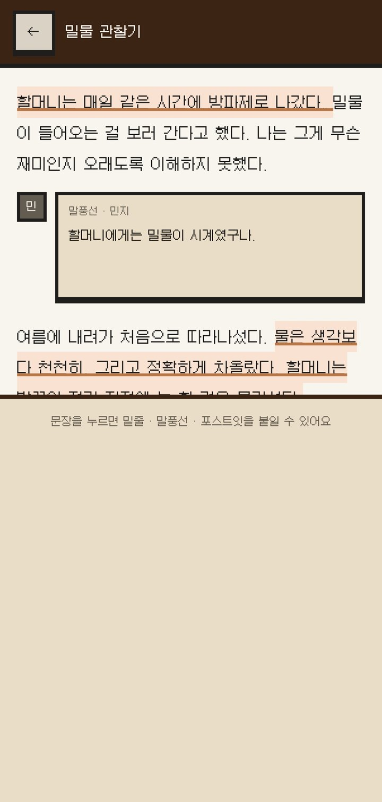
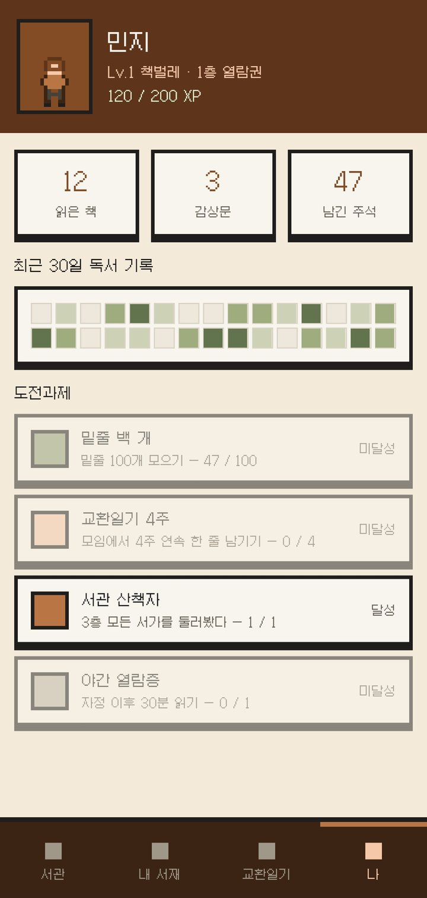

# 픽셀 책방 일지 (Pixel Book Journal)

🔗 **웹 데모:** https://rnjsalswl.github.io/Book-journal/  ·  📐 **설계 문서:** [docs/DESIGN.md](docs/DESIGN.md)

   

픽셀 도서관을 걸어 다니며 사서 NPC에게 독서 퀘스트를 받고, 전자책 문장에 밑줄·말풍선·포스트잇을 친구와 함께 남기는 소셜 독서 앱입니다. 소모임 교환일기("수요일의 책상")와 독서 잔디·업적이 있는 프로필까지 Flutter 하나로 Android·iOS·웹을 만들고, 백엔드는 Supabase(Postgres + Auth + Realtime)를 씁니다.

HTML 인터랙티브 프로토타입으로 화면 흐름을 먼저 검증한 뒤, 실제 계정과 데이터가 있는 앱으로 다시 만들었습니다.

## 주요 기능

- **서관**: 횡스크롤 픽셀 맵, 사서 NPC 대화와 독서 퀘스트
- **내 서재**: EPUB 올리기(기기 안에서 파싱), 책장, 리더
- **리더**: 문장 단위 밑줄·말풍선·포스트잇, 답글, "친구가 지금 여기 읽는 중" 표시(Realtime Presence)
- **교환일기**: 모임 피드, 반응
- **나**: 레벨·XP, 최근 30일 독서 잔디, 도전과제

## 기술 스택

| 영역 | 기술 |
|---|---|
| 앱 | Flutter (Dart), flutter_riverpod |
| 백엔드 | Supabase — Postgres, Auth, Realtime |
| 권한 | Postgres RLS (테이블 14개, 정책 30개) + 본인 확인을 거치는 RPC |
| 배포 | GitHub Pages (웹 빌드) |

## 설계 포인트

**책 본문은 서버에 올리지 않습니다.** 전자책은 대부분 저작권이 있어서, EPUB은 기기 안에서 풀고(`lib/data/epub_parser.dart`) 본문은 기기 저장소에만 둡니다. 서버에는 책 제목·저자와 밑줄의 **좌표(문단 번호, 문장 번호)** 만 올라갑니다. 같은 판본을 가진 친구끼리는 좌표로 같은 문장을 찾아 서로의 밑줄을 볼 수 있습니다.

**권한은 앱이 아니라 DB가 막습니다.** 같은 모임 멤버만 서로의 밑줄·피드를 볼 수 있도록 RLS 정책으로 제한하고, XP·배지처럼 한 번에 처리해야 하는 계산은 DB 함수(RPC)에서 호출자 본인 확인과 값 범위 검사를 거칩니다(`0006_rpc_caller_checks.sql`).

**본문 출처를 갈아끼울 수 있습니다.** 기기 저장본 → 외부 도서 API → 내장 샘플 순으로 찾는 `BookContentSource` 체인이라, 출처가 바뀌어도 리더 화면 코드는 그대로입니다.

자세한 구조와 그림은 [설계 문서](docs/DESIGN.md)에 있습니다.

## 실행

1. [supabase.com](https://supabase.com)에서 프로젝트를 만들고, SQL 에디터에서 `supabase/migrations/`의 파일을 **번호 순서대로** 실행합니다.

   | 파일 | 내용 |
   |---|---|
   | `0001_init.sql` | 테이블, RLS 정책, 가입 시 프로필 생성 트리거 |
   | `0002_seed.sql` | 데모 책 목록, 업적 정의 |
   | `0003_functions.sql` | XP·반응·배지·독서 기록 RPC |
   | `0004_book_content.sql`, `0005_book_external_ref.sql` | 책 본문 출처 관련 컬럼 |
   | `0006_rpc_caller_checks.sql` | RPC 본인 확인·값 범위 제한 |

2. Project Settings → API에서 **Project URL**과 **publishable(anon) 키**를 복사합니다.
3. 실행합니다.

```bash
flutter pub get
flutter run \
  --dart-define=SUPABASE_URL=https://YOUR-PROJECT.supabase.co \
  --dart-define=SUPABASE_ANON_KEY=YOUR-ANON-KEY
# 웹: flutter run -d chrome --dart-define=...
```

두 값이 없으면 앱은 "Supabase 설정이 필요해요" 화면에서 멈춥니다.

## 폴더 구조

```
lib/
  core/       Supabase 연결, --dart-define 읽기
  models/     데이터 클래스 (Book, Profile, BookAnnotation …)
  data/       기능별 repository, EPUB 파서, 본문 출처 체인
  state/      Riverpod provider
  theme/      팔레트, 픽셀 폰트(Galmuri11), 테두리·그림자 스타일
  widgets/    공용 픽셀 위젯
  screens/    서관(맵), 내 서재, 리더, 감상문, 교환일기, 프로필, 로그인
supabase/
  migrations/ 번호 순서대로 실행하는 SQL
test/         EPUB 파이프라인 테스트, 화면 골든 이미지 테스트
```

## 테스트

- `flutter analyze`
- `flutter test` — EPUB 파싱 파이프라인, 로그인·감상문·맵 화면 골든 이미지(`test/goldens/`)
- `flutter build web`

## 아직 남은 것

- 모임 초대가 없어서 지금은 `group_members`에 직접 추가해야 합니다 → 이메일 초대 흐름 예정
- 판본이 다르면 밑줄 좌표가 어긋날 수 있습니다 → 판본 지문 비교 예정
- 픽셀 스프라이트는 코드로 그린 임시 그림입니다
