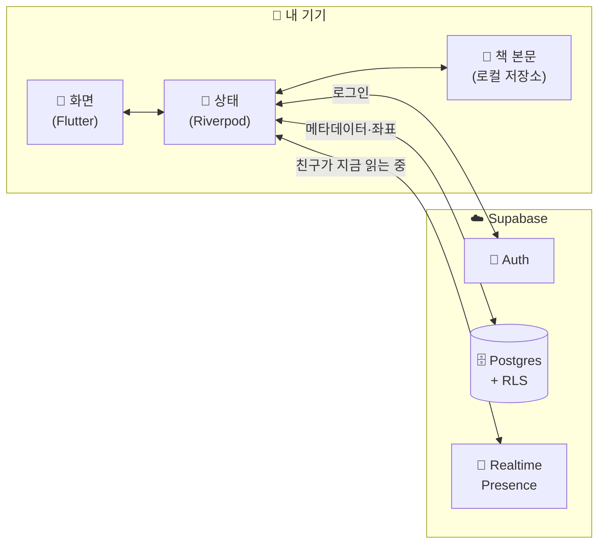
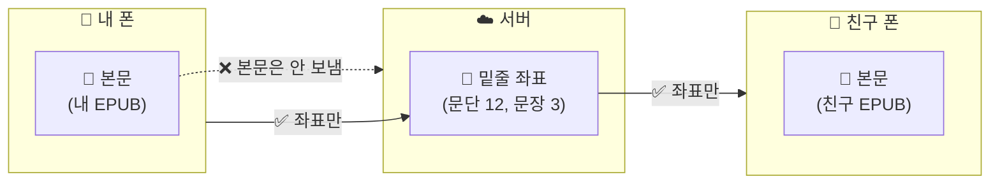
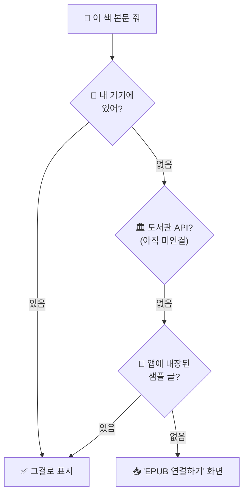
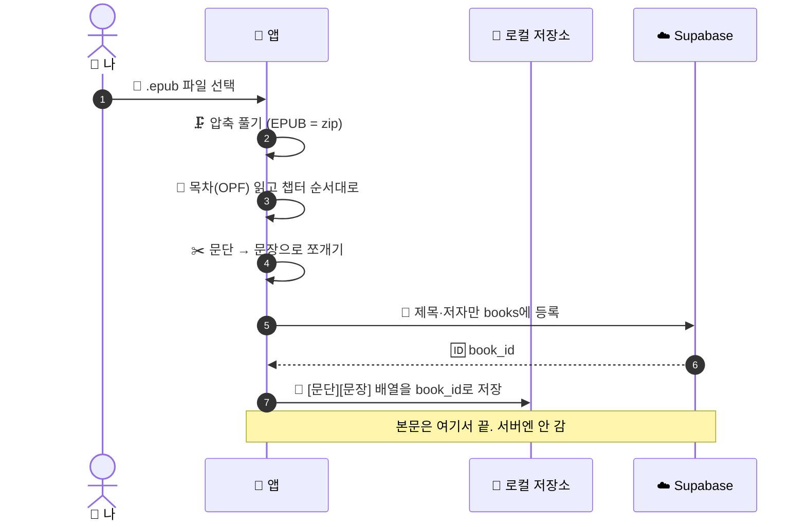
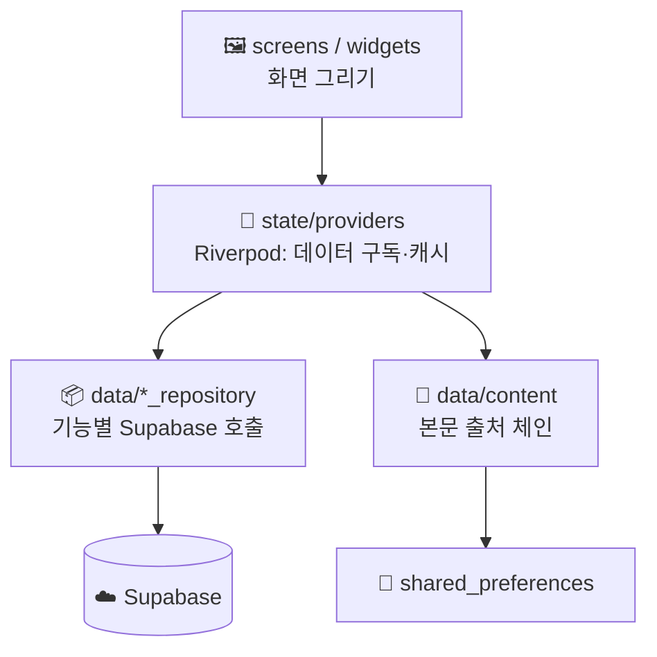
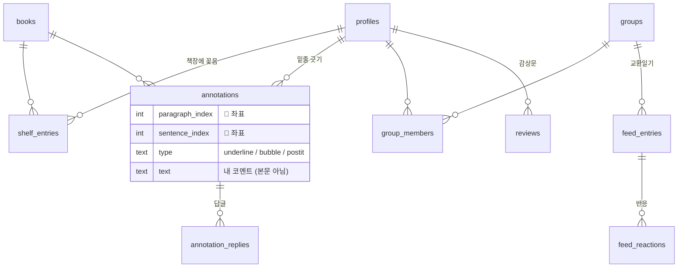

# 픽셀 책방 일지 (Book-journal) 설계 문서

> **한 줄 요약:** 픽셀 도서관을 돌아다니며 책을 읽고, **친구와 같은 문장에 밑줄·댓글을 다는** 소셜 독서 앱이에요.

> 📌 `gh-pages` 브랜치는 웹 빌드 결과물이에요.

---

## ⏱️ 30초 요약

- 📱 **Flutter** 하나로 안드로이드·iOS·웹을 다 만들어요
- ☁️ 백엔드는 **Supabase** (Postgres + 로그인 + 실시간)
- 📚 **책 본문은 서버에 절대 안 올려요** → 저작권 때문에 **내 기기에만** 저장해요
- 📍 서버엔 밑줄의 **"좌표"(몇 번째 문단, 몇 번째 문장)** 만 올라가요
- 🔒 "누가 뭘 볼 수 있나"는 **DB가 직접 막아요** (RLS)

---

## 📚 목차

1. [전체 그림](#1-전체-그림)
2. [핵심 아이디어: 본문은 내 폰, 좌표만 서버](#2-핵심-아이디어-본문은-내-폰-좌표만-서버)
3. [책 본문은 어디서 와요?](#3-책-본문은-어디서-와요)
4. [EPUB을 넣으면 일어나는 일](#4-epub을-넣으면-일어나는-일)
5. [코드는 이렇게 나뉘어 있어요](#5-코드는-이렇게-나뉘어-있어요)
6. [데이터와 권한](#6-데이터와-권한)
7. [아직 부족한 점](#7-아직-부족한-점)

---

## 1. 전체 그림



**탭 4개:**

| 탭 | 뭘 해? |
|---|---|
| 🗺️ **서관** | 픽셀 도서관 맵을 걸어 다니고, 사서 NPC한테 독서 퀘스트 받기 |
| 📚 **내 서재** | 책장, EPUB 올리기, 리더(밑줄·말풍선·포스트잇) |
| 📔 **교환일기** | 소모임("수요일의 책상") 피드, 반응 달기 |
| 🙋 **나** | 레벨·XP, 독서 잔디(히트맵), 업적 |

---

## 2. 핵심 아이디어: 본문은 내 폰, 좌표만 서버

친구랑 **같은 책을 각자 한 권씩** 사서 읽는다고 생각해보세요.
"37쪽 셋째 줄 좋더라" 하면, 책 내용을 보내지 않아도 친구가 자기 책에서 찾을 수 있죠.



| 서버에 **올라가는** 것 ✅ | 서버에 **절대 안 올라가는** 것 ❌ |
|---|---|
| 책 제목·저자·카테고리 | 책 본문 |
| 밑줄 위치 `(paragraph_index, sentence_index)` | 밑줄 친 **문장 내용** |
| 내가 쓴 댓글·포스트잇 | |

> 💡 **왜?** EPUB은 대부분 저작권이 있어요. 서버에 올리는 순간 "불법 공유"가 돼요. 좌표만 공유하면 **서버는 내용을 모르는 채로** 위치만 맞춰줘요.

> ⚠️ **조건:** 친구와 내가 **같은 판본**을 넣어야 좌표가 맞아요.

---

## 3. 책 본문은 어디서 와요?

**"첫 번째로 찾은 곳에서 가져오기"** 규칙이에요. 줄 서 있는 순서대로 물어봐요.



코드로 보면 **인터페이스 하나 + 구현 여러 개**예요.

```dart
abstract class BookContentSource {
  Future<List<List<String>>?> fetch(String bookId);  // null = "나한텐 없어, 다음!"
}
```

| 구현체 | 하는 일 |
|---|---|
| `LocalDeviceContentSource` | 기기에 저장된 EPUB 본문 |
| `LibraryApiContentSource` | 🔌 **빈자리.** 도서관 전자책 API가 생기면 **이 파일만** 채우면 돼요 |
| `SeedContentSource` | 앱에 같이 들어 있는 저작권 없는 짧은 글 2편 |
| `CompositeBookContentSource` | 위 셋을 **순서대로** 물어보는 묶음 |

> 💡 **왜 이렇게?** 리더 화면은 본문이 **어디서 왔는지 몰라도** 돼요. 새 출처가 생겨도 리더 코드는 안 건드려요. (전략 패턴 + 책임 연쇄)

---

## 4. EPUB을 넣으면 일어나는 일



**문장 쪼개기 규칙** (`text_segmenter.dart`):
1. `<p>`, `<h1~4>`, `<li>`, `<blockquote>`를 **문단**으로 봐요
2. `.` `!` `?` `…` `。` 뒤에 공백이 오면 **문장 끝**으로 봐요

> 💡 이 규칙이 **모든 출처에 똑같이** 적용돼야 좌표가 맞아요. 그래서 함수 하나로 모아뒀어요.

---

## 5. 코드는 이렇게 나뉘어 있어요



| 폴더 | 뭐가 있어? |
|---|---|
| `core/` | Supabase 연결, 실행 옵션(`--dart-define`) 읽기 |
| `models/` | 데이터 모양 (Book, Profile, Annotation…) |
| `data/` | 📦 **테이블/기능당 repository 하나씩** (책, 밑줄, 피드, 퀘스트, 뱃지…) |
| `data/content/` | 📖 본문 출처 체인 (3번 참고) |
| `state/` | Riverpod provider |
| `theme/` | 픽셀 색·글꼴·"두꺼운 테두리 + 그림자" 스타일 |
| `screens/map/` | 🗺️ 맵 게임 루프, `CustomPainter`로 그리는 픽셀 스프라이트, NPC 대사 |

**읽기/쓰기 패턴:**
- 📖 **읽기**: `FutureProvider`가 Supabase에서 가져와서 캐시
- ✍️ **쓰기**: repository 호출 → `ref.invalidate()`로 캐시 무효화 → 화면이 알아서 다시 읽음

**실시간 "친구가 여기 읽는 중":**
- 📡 Supabase **Realtime Presence** 채널 `reader:{bookId}`에 들어가서 "나 지금 몇 번째 문단" 공유
- 🗑️ DB 테이블이 **없어요** → 앱 끄면 사라지는 휘발성 정보라서요

---

## 6. 데이터와 권한



### 🔒 권한은 DB가 직접 막아요 (RLS)

앱 코드가 아니라 **Postgres 규칙(Row Level Security)** 으로 막아요. 앱이 실수해도 DB가 한 번 더 거절해요.

| 테이블 | 누가 볼 수 있어? |
|---|---|
| 📍 annotations | **나** + **같은 모임 멤버** |
| 💬 annotation_replies | 부모 밑줄을 볼 수 있는 사람 |
| 📔 feed_entries | **그 모임 멤버만** |
| 📚 books | 로그인한 누구나 (메타데이터뿐이라서) |

**한 번에 끝나야 하는 계산**(XP 레벨업, 반응 토글, 뱃지 진행도)은 **DB 함수(RPC)** 로 만들었어요. 앱에서 "읽고 → 더하고 → 쓰기"를 하면 두 기기에서 동시에 할 때 값이 꼬이거든요.

---

## 7. 아직 부족한 점

- [ ] 🚨 **XP·독서시간 함수에 본인 확인이 없어요.** `increment_profile_xp(p_user_id, p_amount)`, `increment_reading_minutes(p_user_id, …)`가 `security definer`(RLS 무시)인데 `p_user_id = auth.uid()` 검사가 없어요 → 로그인한 사람 누구나 **남의 XP를 마음대로** 올릴 수 있어요. 음수나 엄청 큰 값도 막지 않아요
  - 고치는 법: 함수 안에서 `if p_user_id <> auth.uid() then raise exception …` + 값 범위 제한
- [ ] 👥 모임 초대 기능이 없어요 (지금은 DB에 `group_members`를 직접 넣어야 해요)
- [ ] 📍 판본이 다르면 좌표가 어긋나요 → 책마다 문단 수 같은 "지문(fingerprint)"을 저장해서 판본이 다르면 경고하면 좋아요
- [ ] 💾 본문이 `shared_preferences`에 있어요 → 큰 책엔 안 맞아요. 파일 저장소나 SQLite로 옮기는 게 좋아요
- [ ] 🏛️ `LibraryApiContentSource`는 아직 빈 껍데기예요 (의도된 확장 지점)
- [ ] 🖼️ 픽셀 스프라이트는 코드로 그린 임시 그림이에요
